I turn <b>AI/ML ideas into shipped software</b> — model experiments, agent tooling and mobile apps that people actually download. 
把 AI 點子做成真正上線、有人在用的產品 · Taiwan 🇹🇼

<kbd>&nbsp;▶ CLICK&nbsp;</kbd>&nbsp; <code>decrypt ./about.enc --key=curiosity</code> &nbsp;who is behind this terminal?

 

- **Role** — AI product engineer · student builder · Taiwan
- **Focus** — AI products · full-stack systems · applied ML · agent tooling
- **Shipped** — [Zonr](https://zonr.pro) on iOS + Android · [Google Play Preflight Skills](https://github.com/masddffee/google-play-preflight-skills)
- **Research** — [LensGuard](https://github.com/tyc4d/LensGuard): safe actions for vision-AI assistants (research & product lead)
- **Method** — problem → prototype → evidence → ship

 

  
  
  
  

  
  
  

  

Rendered daily by GitHub Actions from the GraphQL <code>contributionsCollection</code> — the same data as the green squares, with private work counted anonymously. No repository names or commit messages are ever drawn.

<kbd>&nbsp;▶ CLICK TO SUMMON&nbsp;</kbd>&nbsp; <b>the orbit</b> &nbsp;every avatar here was dropped in by a visitor

 

  🛸 <a href="https://github.com/masddffee/masddffee/issues/new?title=orbit%3A%20join&body=Hit%20%2A%2ASubmit%20new%20issue%2A%2A%20to%20drop%20your%20avatar%20into%20the%20orbit%20on%20my%20profile%20README.%0A%0AA%20GitHub%20Action%20adds%20your%20public%20username%20%2B%20avatar%2C%20re-renders%20the%20orbit%20and%20closes%20this%20issue%20automatically.%20Nothing%20else%20is%20collected."><b>Join the orbit</b></a> — submit the pre-filled issue and a GitHub Action drops your avatar in within a minute.

