


<a href="https://zonr.pro"></a>
<a href="https://github.com/tyc4d/LensGuard"></a>

<a href="https://github.com/masddffee/masddffee/issues/new?title=orbit%3A%20join&body=Hit%20%2A%2ASubmit%20new%20issue%2A%2A%20to%20drop%20your%20avatar%20into%20the%20orbit%20on%20my%20profile%20README.%0A%0AA%20GitHub%20Action%20adds%20your%20public%20username%20%2B%20avatar%2C%20re-renders%20the%20orbit%20and%20closes%20this%20issue%20automatically.%20Nothing%20else%20is%20collected."></a>

I turn <b>AI/ML ideas into shipped software</b> — model experiments, agent tooling and mobile apps that people actually download. 
把 AI 點子做成真正上線、有人在用的產品 · Taiwan

<kbd>&nbsp;▶ CLICK&nbsp;</kbd>&nbsp; <b>decrypt the profile</b>

 

- **Building** — [Zonr](https://zonr.pro), live on iOS + Android
- **Research** — [LensGuard](https://github.com/tyc4d/LensGuard), research & product lead
- **Contact** — houbaian54@gmail.com

 

<a href="https://zonr.pro"></a>

  <a href="https://zonr.pro"></a>
  
  

  <a href="https://github.com/tyc4d/LensGuard"></a>
  <a href="https://github.com/masddffee/google-play-preflight-skills"></a>

 

  


  

Refreshed daily from GitHub's contribution data · private work is counted, never named.

<kbd>&nbsp;▶ CLICK TO SUMMON&nbsp;</kbd>&nbsp; <b>the orbit</b>

 

  ▸ <a href="https://github.com/masddffee/masddffee/issues/new?title=orbit%3A%20join&body=Hit%20%2A%2ASubmit%20new%20issue%2A%2A%20to%20drop%20your%20avatar%20into%20the%20orbit%20on%20my%20profile%20README.%0A%0AA%20GitHub%20Action%20adds%20your%20public%20username%20%2B%20avatar%2C%20re-renders%20the%20orbit%20and%20closes%20this%20issue%20automatically.%20Nothing%20else%20is%20collected."><b>Join the orbit</b></a> — your avatar lands here in about a minute.

